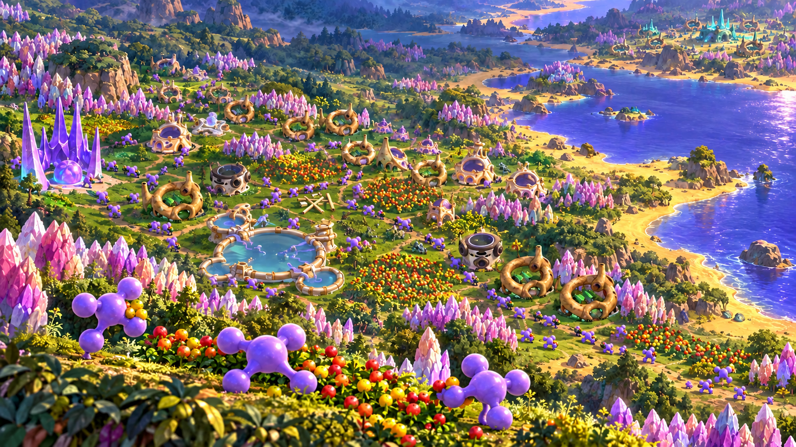

# Character correction study — review only

[Store profile](../../planning/epic-store-profile-v1.md) · [Source asset ledger](../../facts/assets.md) · [Exact prompts and inputs](prompts.md)

Prepared **2026-10-26** after the user rejected the first store artwork as presentation-like, then identified incorrect globs in the illustrated revision. **Awaiting user character feedback.** This is a character-correction study, not an approved cover or submission asset. No title, portrait or production exports have been prepared from it.

The image is a generated promotional illustration, **not gameplay or a screenshot**. The initial generated creatures incorrectly resembled muscular humanoids. The correction uses original-derived game renders and the project icon as identity references: a continuous central oval with four tapering connections and rounded terminal lobes, without separate human head/neck, hands or musculature. It retains the colony composition for comparison. Closer source resemblance is a reviewer observation, not user approval of the anatomy or visual style.

## Retained file

- [character-correction-study.png](character-correction-study.png): native **1672×941**, 3,288,232 bytes; no resizing or title overlay. SHA-256: `9d55cbdcc279ede805e006b7c2d65704728db0a4c65bdb68bd0eb232b8d368e5`.
- [prompts.md](prompts.md): exact initial and corrective built-in image-generation prompts, ordered inputs, method and output identities. Rejected humanoid images are not included in this pack.

## Reference provenance

- Game original-derived worker `datasrc/gfx/production/original-derived/unit256r.png`, warrior `unit1024r.png`, explorer `unit0r.png`; [game source revision](https://github.com/Globulation2/glob2/tree/7ebec312cd2bdcb6b6f685e141726b8caaca9ef7).
- [Design-system revision](https://github.com/Globulation2/glob2-design-system/tree/acd277710acfebf528e1fc6f653d55fdf75de4b2): worker sprite, inn, colony scene and stylized glob icon. The temporary audit board compared the original-derived species silhouettes with the website sprites and icon.
- [Website revision](https://github.com/Globulation2/glob2-online-website/tree/6e391ebe93b725747827a3ed7cea78f0d0d8f7e1): `public/images/home-thriving-colony.webp`, a replay crop used for world/building references. Fog/HUD context remains documented in the [asset ledger](../../facts/assets.md#screenshots-recordings-and-educational-media).

Reference artwork provenance and GPL-related notices remain subject to release-specific review; generation does not resolve usage-rights questions. Third-party game store images informed composition research only and were not supplied to the image model or used in this illustration.

Next: obtain feedback on the corrected organism shape before further illustration, title treatment, portrait composition or export work. This study does not replace the rejected v1 files as an approved store pack.
