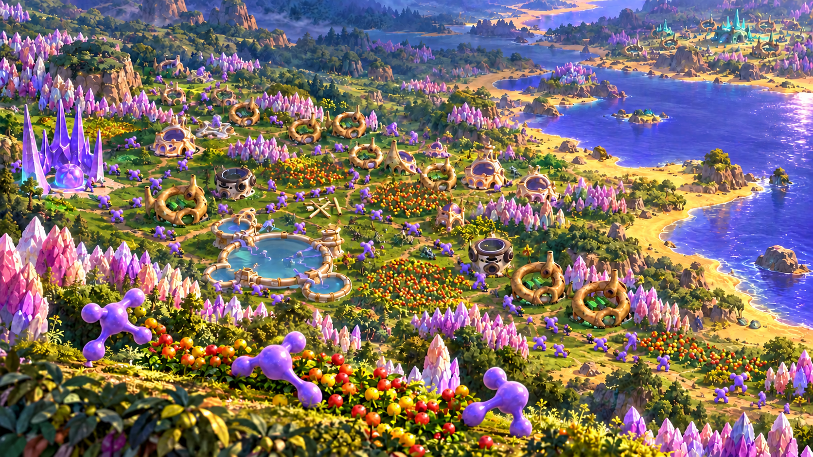

# Role-specific character study — review iteration

[Actual worker and warrior references](../epic-v2/unit-references/README.md) · [Prior study](../epic-v2/README.md) · [Exact prompt](prompts.md) · [Epic profile](../../planning/epic-store-profile-v1.md)

Prepared **2026-10-26** after the user specified that workers are longer and more slender, while warriors are bulkier, and asked to use real images of the units. This is a **rejected anatomy study**, retained to record the failed source-reference edit. The coordinating review found that the globs still looked round and toy-like rather than matching the actual units. It is not finished cover art or a submission asset. No title, portrait or store-sized exports were made.

## Method and observed limitation

One built-in image-generation edit used the prior landscape as its environment target and actual role-specific game renders as character identity references. The real worker/warrior comparison and three unchanged source frames were supplied directly; the stylized mascot icon was not supplied. See the [reference manifest](../epic-v2/unit-references/README.md) for exact source frame mappings, hashes and rights context.

The result lengthens the prominent workers' connections and poses. However, their central bodies remain round and glossy, and some ball-ended toy-like silhouette persists. This is a reviewer observation: **exact source fidelity has not been established**, and the scene must not be presented as an approved depiction of the units. The background role distinction is also not independently verified. Do not build further cover variants on the assumption that the anatomy is accepted.

This remains a generated promotional illustration, not actual gameplay or a screenshot. The colony environment derives from the previous study; its reference provenance is retained in that record. Generation does not settle release-specific source-art usage-rights questions.

## Retained file

- [role-specific-character-study.png](role-specific-character-study.png): native **1672×941** RGB, 3,234,163 bytes, copied without resizing or overlays. SHA-256: `db8b6b12aa807e3ceb39ad2b6191f4f949ed5c7c6ace6645072feb97d6f7c1e4`.
- [prompts.md](prompts.md): exact successful edit prompt, input order, method and output identity.

Do not use this study for further cover production. The next direction preserves the real units through actual game imagery and the existing title, without AI reinterpretation of character anatomy. Store artwork remains in progress pending visual review.
