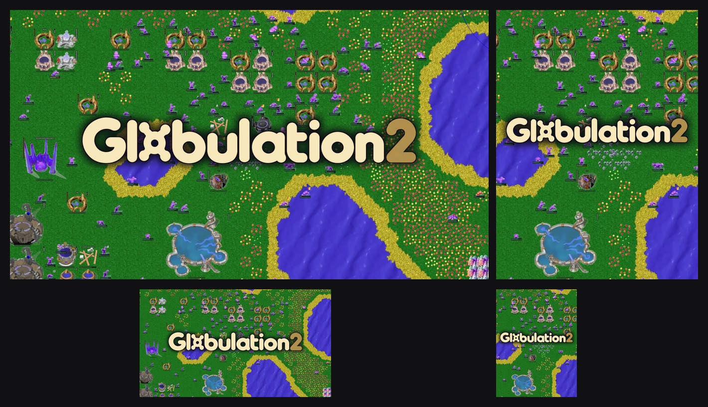

# Actual-game store-cover direction — review draft

[Epic profile](../../planning/epic-store-profile-v1.md) · [Store reference review](../../planning/store-art-reference-review.md) · [Actual unit references](../epic-v2/unit-references/README.md)

Prepared **2026-10-26** following the user's request to use real glob images and preserve the longer, slender workers and bulkier warriors. This direction uses an existing actual-game scene at its native resolution, with the exact existing title over it. **Review draft; user acceptance is pending.**



## Files and treatment

| File | Native dimensions | Treatment |
| --- | --- | --- |
| [Landscape](landscape-native-1280x720.png) | 1280×720 | Whole source scene, edge to edge; native-size 900px wordmark centered with contour-following dark shadow. |
| [Portrait](portrait-native-540x720.png) | 540×720 | Unscaled scene crop `(315, 0, 855, 720)`; wordmark reduced to 488px. |
| [Review sheet](review-contact-sheet.jpg) | 1420×816 | Both compositions and smaller thumbnail checks; not a store upload. |
| [Build script](build-assets.py) | Python / Pillow | Rebuilds the compositions from the sibling website and design-system source files. |

The units, buildings and terrain are the actual source pixels. No creature was generated, redrawn, enlarged, cut out or replaced. No image-generation tool was used for this version. The only visual additions are the title and its localized contour/shadow treatment. There is no inset screenshot, explanatory slogan or presentation panel. The prior generated studies remain unapproved.

These are **native visual-direction previews**, not Epic-sized deliverables or fresh gameplay captures. They do not meet the 1920×1080 carousel or larger offer dimensions. No enlargement is disguised as a higher-resolution capture. A new matching capture is needed for final production at the required sizes.

## Source provenance

- Scene: website `public/images/home-thriving-colony.webp`, 1280×720, [revision 6e391eb](https://github.com/Globulation2/glob2-online-website/tree/6e391ebe93b725747827a3ed7cea78f0d0d8f7e1). The [capture record](https://github.com/Globulation2/glob2-online-website/blob/6e391ebe93b725747827a3ed7cea78f0d0d8f7e1/docs/website-content-verification.md) identifies a **2026-10-11 replay**, four-colony Fingerprint / Quick clash, tick 41350, fog disabled and outer HUD cropped. Do not describe it as a new normal player-view capture of the Epic Windows build.
- Title: design-system `assets/wordmark-letters.webp` and `assets/wordmark-two.webp`, both 900×131, [revision acd2777](https://github.com/Globulation2/glob2-design-system/tree/acd277710acfebf528e1fc6f653d55fdf75de4b2), composed in the maintained cream `#f9e8bb` and gold `#e2b85f`. No title redesign or additional font was introduced.
- The [source asset ledger](../../facts/assets.md) and design-system [provenance manifest](https://github.com/Globulation2/glob2-design-system/blob/acd277710acfebf528e1fc6f653d55fdf75de4b2/assets/provenance.json) retain art provenance and GPL-related rights context. This draft does not complete the release's rights/credits review.

Source SHA-256:

```text
home-thriving-colony.webp 39e0ade8d634801955f55897257eb8abc6ae4f75a07dd64ae81024eefff24371
wordmark-letters.webp 428fc52ed064debfe273d529c4cd81284a45160879d05afff7775929a35d206d
wordmark-two.webp a33008a9088f98edb64ff494bc38f3888849f562113be90ca191c48bbb5291a2
```

## Checks and next work

Image decoding and native dimensions were checked. Pixel comparisons confirm source equality above and below the localized title treatment for both compositions. Parent review inspected title readability at 384px-wide landscape and 162px-wide portrait thumbnails.

Next: review this actual-game cover direction, then obtain a current, sufficiently large capture and fit final title placement to Epic's critical-area templates. No store fields, uploads or source-project assets were changed.
