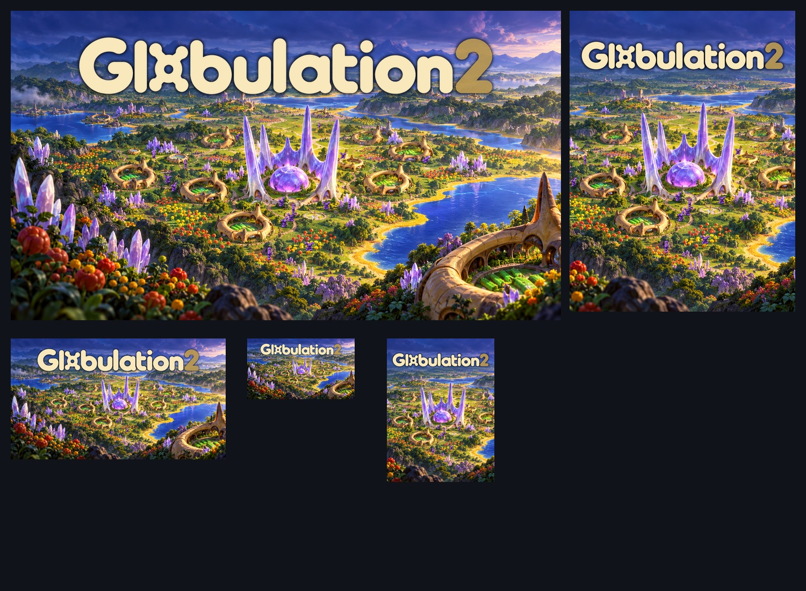

# Illustrated colony store artwork

[Epic profile](../../planning/epic-store-profile-v1.md) · [Official requirements](../../planning/epic-store-requirements.md) · [Actual unit references](../epic-v2/unit-references/README.md)

Prepared **2026-10-26** as the working art direction for a professional Epic presentation. The illustrated environment presents the colony-building and economic promise; real game renders preserve the worker and warrior shapes. The landscape cover and product logo used in the final [page presentation](../epic-page-preview/README.md) were approved for use on 2026-10-30; see the [approved rollout record](../../planning/approved-storefront-rollout.md). The portrait is an existing export of the same family and needs its destination crop preview. Approval is separate from an actual store upload. Genuine gameplay images remain a separate gallery.

## Delivery files

| File | Use |
| --- | --- |
| [Landscape JPG](offer-landscape-2560x1440.jpg) / [PNG master](offer-landscape-2560x1440.png) | 2560×1440 general/library landscape draft |
| [Portrait JPG](offer-portrait-1200x1600.jpg) / [PNG master](offer-portrait-1200x1600.png) | 1200×1600 general/library portrait draft |
| [Product logo](product-logo-960x540.png) | Transparent 960×540 PNG; 38,025 bytes |
| [Environment](environment-native.png) | Unchanged native 1672×941 generated environment, with no creatures |
| [Colony composite](colony-native.png) | Native environment plus real worker/warrior renders, before title placement |
| [Build script](build-assets.py) | Rebuilds the unit/title composites and exports from retained environment/source files |
| [Prompts](prompts.md) / [manifest](manifest.json) | Exact built-in generation prompt/input identities; output hashes/dimensions |

The existing title is the sole cover text. Landscape and portrait use separate title placement; the portrait deliberately crops the central hive, colony and foreground rather than squeezing the landscape. The offers meet the dimensions/formats in the [official media guide](https://dev.epicgames.com/docs/epic-games-store/sales-and-marketing/marketing/storefront-media-guide). Exact critical-area/template preview remains a portal check. The wide product wordmark still needs its spacing checked in that preview.

## Source identity and transformations

- **Environment:** built-in image generation, one call, using the actual website colony, design-system hive and inn as references. Native output was copied unchanged into this project. It is promotional illustration, never gameplay or a claim about the game's renderer. Exact prompt/input roles are retained in [prompts.md](prompts.md).
- **Architecture references:** website `public/images/home-thriving-colony.webp`, [revision 6e391eb](https://github.com/Globulation2/glob2-online-website/tree/6e391ebe93b725747827a3ed7cea78f0d0d8f7e1); design-system `assets/swarm.webp` and `assets/inn.webp`, [revision acd2777](https://github.com/Globulation2/glob2-design-system/tree/acd277710acfebf528e1fc6f653d55fdf75de4b2). The world art interprets their organic forms rather than altering a screenshot.
- **Characters:** the [six unchanged worker/warrior source renders](../epic-v2/unit-references/README.md), from game revision `7ebec312cd2bdcb6b6f685e141726b8caaca9ef7`. Fifteen workers and two peripheral warriors use their actual frame geometry and alpha silhouettes. Each 128px frame is reduced to 29–57px in the native composition. A fixed HSV hue shift of +0.325, saturation ×0.88 and value ×0.94 provides purple team tint; source alpha/proportions are retained except the alpha=1 empty-background sentinel is normalized to zero. No character anatomy is generated, traced or redrawn. A small ground shadow is added at each placement.
- **Title:** existing two 900×131 alpha masks, design-system `assets/wordmark-letters.webp` and `assets/wordmark-two.webp`, in maintained cream `#f9e8bb` and gold `#e2b85f`. Landscape title is enlarged from the native mask; portrait has its own scale. No new title design or additional font is introduced.
- **Export resampling:** the native illustrated composite is resampled to Epic offer dimensions. The portrait uses source crop `(483, 0, 1189, 941)`. This is ordinary illustration export resampling, not a claim of newly captured high-resolution gameplay. PNG masters and compressed JPG delivery variants share the same composition.

Game-art provenance and license context remain in the [asset ledger](../../facts/assets.md), the design-system [provenance manifest](https://github.com/Globulation2/glob2-design-system/blob/acd277710acfebf528e1fc6f653d55fdf75de4b2/assets/provenance.json), and retained [game COPYING notice](../epic-v2/unit-references/COPYING). Release-specific credit/rights review remains part of publication preparation.

## Visual and file checks

Parent review inspected the full composition, the 200px-wide landscape title/hive hierarchy and the portrait framing. Unit placements were checked against the native environment, with river placements removed and units kept on terrain, paths or economic plots. Decoding, dimensions, product-logo alpha/size and output hashes are recorded in the manifest. No Epic account, field, upload or publication was changed.
